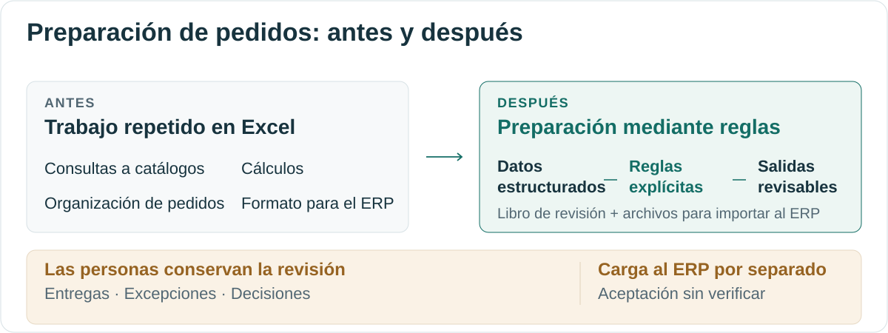
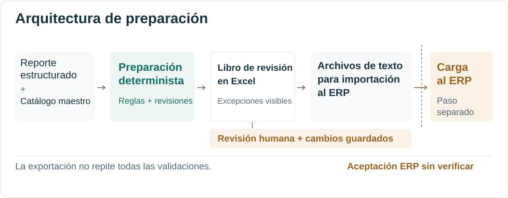
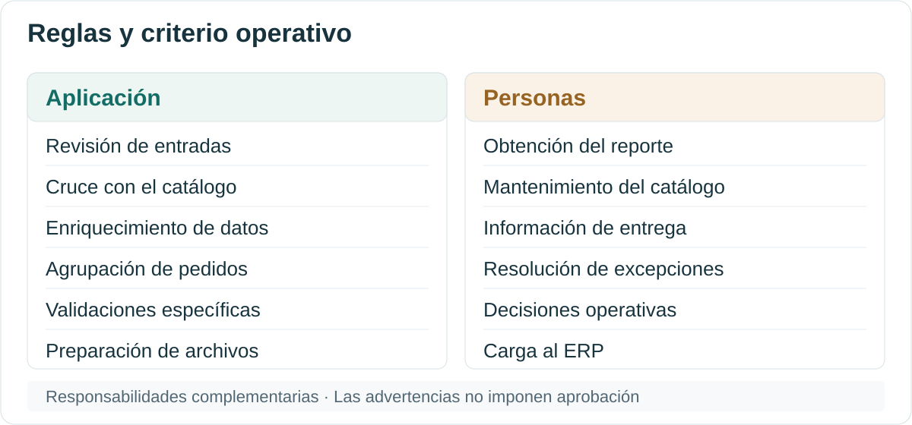

# Preparación de pedidos — Hacer repetibles los procedimientos en Excel

[English](README.md) · [Español (México)](README.es-MX.md)

**Lucas Perezcano**  
Ingeniería Industrial · Tecnológico de Monterrey

Preparar órdenes de compra de clientes para su importación al ERP requería consultas repetidas a catálogos, cálculos en Excel, agrupación de pedidos y ajustes de formato. Mediante entrevistas con empleados, identifiqué una oportunidad para estandarizar esa preparación y trabajé directamente con la persona responsable de realizarla.

Revisamos sus procedimientos en Excel, mapeamos el proceso y tradujimos el conocimiento operativo en requisitos. A medida que las reglas se aclararon, simplifiqué un enfoque inicialmente orientado a inteligencia artificial y lo convertí en automatización determinista: desarrollé la aplicación con Claude Code e iteré con la retroalimentación de la persona responsable. El flujo implementado prepara un libro de revisión en Excel y archivos de texto para importación al ERP, mientras las personas conservan la responsabilidad sobre la información de entrega y las decisiones operativas.

**La validación respalda componentes y transformaciones de referencia específicos. El despliegue organizacional y la adopción operativa en el ERP siguen pendientes; no se ha demostrado la aceptación de las importaciones por el ERP.**

## Partir del procedimiento de la persona responsable

Después de desarrollar una [automatización del procesamiento de facturas](https://github.com/lucas-x-perezcano/case-invoice-workflow), continué entrevistando a empleados sobre tareas operativas repetitivas. En este caso, la entrada ya estaba estructurada, pero una persona todavía tenía que reunir la información que necesitaba el siguiente sistema.

Revisar ese trabajo en conjunto ayudó a hacer explícitas las consultas a catálogos, los cálculos y las reglas de agrupación. La persona responsable aportó su conocimiento de los archivos existentes y de las situaciones que requerían un tratamiento especial. Mapeé el proceso más amplio de pedidos de venta y el flujo de preparación propuesto, convertí los procedimientos en requisitos, y desarrollé y ajusté la aplicación con esa retroalimentación.

Esta colaboración ayudó a distinguir la preparación repetible de las decisiones que necesitaban contexto operativo. Los mapas internos definieron el alcance de la automatización; las ilustraciones siguientes son representaciones conceptuales nuevas, creadas para este caso.

## De la preparación repetitiva a reglas definidas

| Actividad de preparación | Procedimiento existente en Excel | Enfoque implementado |
| --- | --- | --- |
| Enriquecer las partidas | Consultar catálogos y llenar campos. | Realizar el cruce con el catálogo y aplicar transformaciones explícitas. |
| Organizar los pedidos | Crear un índice de pedidos y vincular las partidas de detalle. | Agrupar las referencias de órdenes de compra y asignar claves internas de vinculación. |
| Revisar y dar formato | Inspeccionar valores y organizar las tablas requeridas. | Mostrar inconsistencias definidas y preparar la estructura de los archivos de importación. |

El rediseño estandariza actividades específicas de preparación. Descargar el reporte, mantener los datos maestros, proporcionar información de entrega, resolver excepciones y controlar la carga al ERP siguen siendo responsabilidades humanas.

## Por qué la tecnología se volvió más sencilla

Al principio exploré un enfoque similar al del proyecto de facturas asistido por inteligencia artificial. Aclarar el procedimiento con la persona responsable mostró que las tareas principales eran el cruce con el catálogo, los cálculos repetibles, la agrupación y la salida con formato fijo. El código convencional podía expresar esas reglas directamente.

Por ello, la preparación de pedidos usa procesamiento determinista sin inferencia recurrente de un modelo de lenguaje. Claude Code apoyó el desarrollo de la aplicación; no interpreta cada pedido durante su procesamiento. Eliminar la inferencia recurrente no elimina los costos de mantenimiento, infraestructura u operación.

La decisión de ingeniería surgió del análisis del proceso: usar transformaciones repetibles donde las reglas son explícitas y mantener la intervención humana donde aún se necesita información o criterio.

## Cómo se conectan la preparación y la revisión

Una persona selecciona un reporte estructurado descargado y el catálogo maestro. La aplicación revisa la estructura de entrada, enriquece los datos, agrupa encabezados y partidas, y ejecuta validaciones definidas. Su libro de revisión reúne la información preparada, el índice de pedidos y las excepciones.

La persona revisa el libro, agrega la información de entrega y confirmación, y guarda los cambios. La exportación lee las hojas guardadas y prepara archivos de texto de encabezados y partidas destinados a Data Transfer Workbench (DTW) de SAP Business One. **El comportamiento del generador de libros y del exportador se estableció mediante inspección del código fuente; su ejecución quedó fuera de la auditoría histórica.** La carga al ERP es un paso separado.

**Las advertencias no imponen una aprobación.** La exportación no vuelve a ejecutar todas las validaciones ni sincroniza todos los cambios del libro. Una excepción visible todavía puede requerir una decisión, y pueden ser necesarias actualizaciones coordinadas entre hojas. La aplicación apoya la revisión sin demostrar que un pedido exportado haya sido aprobado o aceptado por el ERP.

## La evidencia y sus límites

La auditoría histórica examinó **un solo conjunto de datos conservado, ya enriquecido**. Diagnósticos separados en memoria reprodujeron las tablas normalizadas de referencia de encabezados y partidas. No validaron una entrada original independiente y sin modificaciones hasta su aceptación por el ERP, ni ejecutaron la carga habitual de configuración y datos maestros, el generador y el exportador actuales, las interacciones de escritorio o la carga al ERP.

**Pasaron 106 pruebas seleccionadas; otros 48 métodos no se ejecutaron porque PyYAML no estaba disponible durante esa auditoría.** Volver a enriquecer la muestra puso de manifiesto **metadatos obligatorios de catálogo incompletos** y **un ajuste manual histórico de cantidad** que difirió de la regla automatizada. Algunas comparaciones de regresión excluyen esos casos.

La aceptación de las importaciones por el ERP, la preparación para producción y la adopción habitual siguen sin verificarse. No se afirman ahorros medidos, retorno de inversión, reducción de errores, un porcentaje de exactitud ni capacidad de procesamiento en producción. El [documento de validación](docs/spanish/validation.md) explica los métodos históricos, las exclusiones y las limitaciones; esta revisión editorial no volvió a ejecutar la auditoría de la aplicación.

## Qué me deja el proyecto

Mi contribución conectó las entrevistas con empleados y el mapeo del proceso con los requisitos, el desarrollo de la aplicación y las iteraciones. El conocimiento operativo de la persona responsable permitió entender los procedimientos con suficiente claridad para simplificar la tecnología. Las brechas del catálogo y las excepciones manuales también mostraron por qué los cálculos reproducibles por sí solos no resuelven todas las cuestiones operativas.

La implementación técnica y la adopción en la organización son etapas separadas. Este caso documenta una herramienta de preparación desarrollada y una validación de alcance delimitado, mientras el despliegue sigue pendiente.

## Contexto técnico y documentos de apoyo

Python, pandas, openpyxl, la configuración YAML y una interfaz en Tkinter apoyan la preparación. La implementación privada define el empaquetado para Windows y un componente separado de carga con PowerShell y DTW.

| Documento | Más detalle |
| --- | --- |
| [Arquitectura](docs/spanish/architecture.md) | Límites de entrada y salida, comportamiento del libro e integración posterior. |
| [Decisiones de diseño](docs/spanish/design-decisions.md) | Definición colaborativa de requisitos, selección de tecnología y compromisos operativos. |
| [Validación](docs/spanish/validation.md) | Muestra histórica, pruebas, comparaciones normalizadas, exclusiones y resultados no verificados. |

## Confidencialidad

La empresa, las identidades de los empleados, los registros de clientes, los catálogos, los precios, las reglas operativas, el código fuente, la configuración y los diagramas internos se mantienen privados. Los elementos visuales son ilustraciones conceptuales originales sin registros reales. Las mediciones y cifras agregadas derivadas del negocio se excluyen de este caso público.
