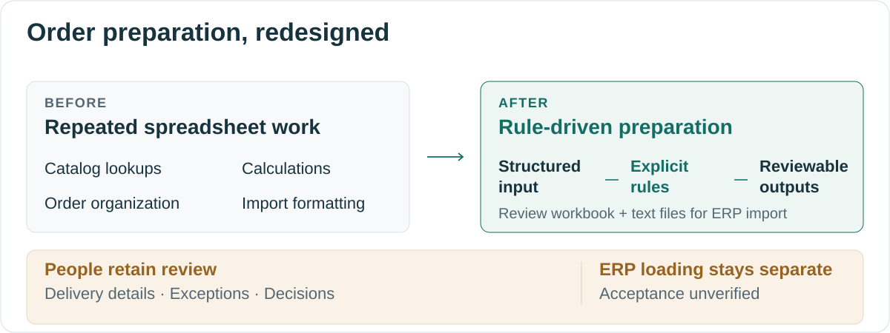
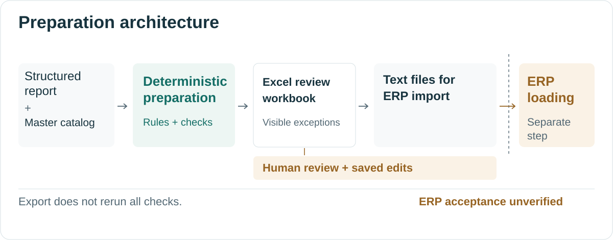
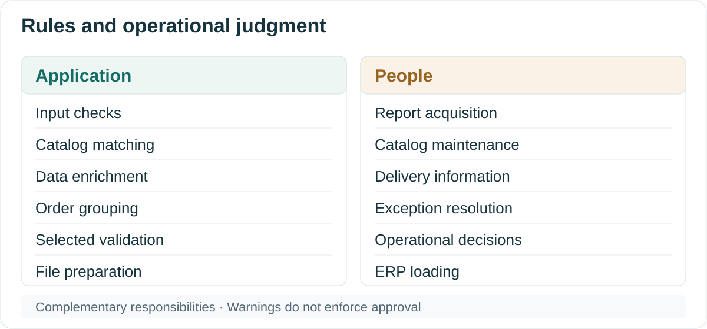

# Order Preparation — Making Spreadsheet Procedures Repeatable

[English](README.md) · [Español (México)](README.es-MX.md)

**Lucas Perezcano**  
Industrial Engineering · Tecnológico de Monterrey

Preparing customer purchase orders for ERP import required repeated catalog lookups, spreadsheet calculations, order grouping, and formatting. Through employee interviews, I identified an opportunity to standardize that preparation and worked directly with the person responsible for it.

We reviewed the employee's Excel procedures, mapped the process, and translated operational knowledge into requirements. As the rules became clearer, I simplified an initially AI-oriented approach into deterministic automation, developing the application with Claude Code and iterating with employee feedback. The implemented workflow prepares an Excel review workbook and text files for ERP import, while people retain responsibility for delivery information and operational decisions.

**Validation supports selected components and reference transformations. Organizational deployment and live ERP adoption remain pending; successful ERP acceptance has not been demonstrated.**

## Working from the employee's procedure

After developing an [invoice-processing automation](https://github.com/lucas-x-perezcano/case-invoice-workflow), I continued interviewing employees about repetitive operational tasks. Here, the input was already structured, but an employee still had to assemble the information required by the next system.

Reviewing that work together helped make the catalog lookups, calculations, and grouping rules explicit. The employee contributed knowledge of the existing files and the situations requiring special treatment. I mapped the broader sales-order process and the proposed preparation workflow, converted the procedures into requirements, and developed and revised the application with that feedback.

This collaboration helped distinguish repeatable preparation from decisions needing operational context. The internal maps defined the automation boundary; the illustrations below are new conceptual artwork created for this case.

## From repeated preparation to defined rules

| Preparation activity | Existing spreadsheet procedure | Implemented approach |
| --- | --- | --- |
| Enrich order lines | Consult catalogs and populate fields. | Match catalog records and apply explicit transformations. |
| Organize orders | Build an order index and connect detail lines. | Group purchase-order references and assign internal linking keys. |
| Check and format | Inspect values and arrange the required tables. | Surface defined inconsistencies and prepare the import-file structure. |

The redesign standardizes selected preparation activities. Downloading the report, maintaining master data, supplying delivery information, resolving exceptions, and controlling ERP loading remain human responsibilities.

## Why the technology became simpler

I initially explored an approach similar to the AI-assisted invoice project. Clarifying the procedure with the employee showed that the main tasks were catalog matching, repeatable calculations, grouping, and fixed-format output. Conventional code could express those rules directly.

Order preparation therefore uses deterministic processing with no recurring language-model inference. Claude Code assisted application development; it does not interpret each order during processing. Removing recurring inference does not eliminate maintenance, infrastructure, or operational costs.

The engineering decision followed the process analysis: use repeatable transformations where rules are explicit and retain people where information or judgment is still needed.

## How preparation and review connect

A person selects a downloaded structured report and the master catalog. The application checks input structure, enriches the data, groups headers and lines, and runs defined validation checks. Its review workbook brings together the prepared information, order index, and exceptions.

The person reviews the workbook, adds delivery and confirmation information, and saves edits. Export reads the saved sheets and prepares header and line text files intended for SAP Business One Data Transfer Workbench (DTW). **Writer and export behavior was established by source inspection; their execution remained outside the historical audit.** ERP loading is a separate step.

**Warnings do not enforce approval.** Export does not rerun all checks or synchronize every workbook edit. A visible exception may still need a decision, and coordinated updates across sheets can be necessary. The application supports review without proving that an exported order was approved or accepted by the ERP.

## Evidence and its limits

The historical audit examined **one retained, already enriched dataset**. Separate in-memory diagnostics reproduced normalized reference header and line tables. They did not validate an independent untouched raw input through to ERP acceptance or exercise normal configuration/master loading, the current writer/exporter, desktop interactions, or ERP loading.

**106 selected tests passed; 48 additional methods were not executed because PyYAML was unavailable during that audit.** Re-enrichment exposed **incomplete required catalog metadata** and **a historical manual quantity adjustment** that differed from the automated rule. Selected regression comparisons exclude those cases.

Successful ERP acceptance, production readiness, and routine adoption remain unverified. No measured savings, ROI, error reduction, accuracy percentage, or production throughput is claimed. The [validation document](docs/english/validation.md) explains the historical methods, exclusions, and limitations; this editorial revision did not rerun the application audit.

## What I take from the project

My contribution connected employee interviews and process mapping to requirements, application development, and iteration. The employee's operational knowledge made the procedures understandable enough to simplify the technology. Catalog gaps and manual exceptions also showed why reproducible calculations alone do not settle every operational question.

Technical implementation and organizational adoption are separate stages. This case documents a developed preparation tool and bounded validation while deployment remains pending.

## Technical context and supporting documents

Python, pandas, openpyxl, YAML configuration, and a Tkinter interface support preparation. Windows packaging and a separate PowerShell/DTW loading component are defined in the private implementation.

| Document | Further detail |
| --- | --- |
| [Architecture](docs/english/architecture.md) | Input and output boundaries, workbook behavior, and downstream integration. |
| [Design decisions](docs/english/design-decisions.md) | Collaborative requirements, technology selection, and operational trade-offs. |
| [Validation](docs/english/validation.md) | Historical sample, tests, normalized comparisons, exclusions, and unverified outcomes. |

## Confidentiality

The company, employee identities, customer records, catalogs, prices, operating rules, source code, configuration, and internal diagrams remain private. The visuals are original conceptual illustrations with no real records. Business-derived measurements and aggregate counts are excluded from this public case.
